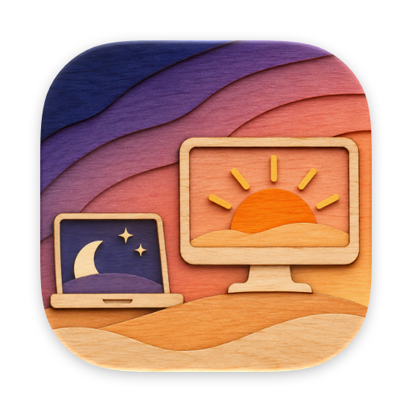
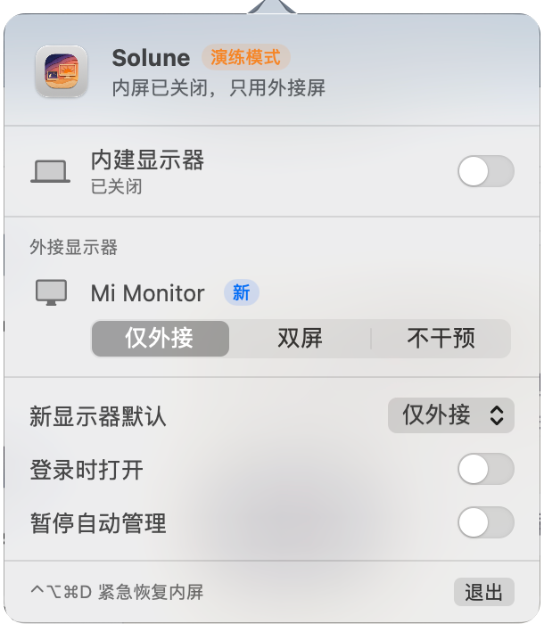
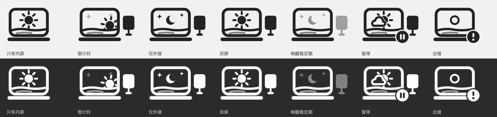

<p align="center">
  
</p>

<h1 align="center">Solune</h1>

<p align="center">
  插上外接显示器，内屏自动关；拔掉，内屏马上回来。<br>
  一个只做这件事的 macOS 菜单栏小工具。
</p>

<p align="center">
  
  
  
  
</p>

---

## 为什么写它

接外接屏时，MacBook 的内屏多数时候是多余的：占着一块桌面，窗口会被甩过去，还白白耗电。macOS 自带的办法只有合盖，但合盖就用不了原生键盘和 Touch ID。

BetterDisplay 之类的工具能关掉内屏，可它们功能很多、常驻内存也大。Solune 只做一件事：**按规则自动断开 / 恢复内屏**。不调分辨率，不调刷新率，不调亮度。

- 空闲时约 15 MB 内存，CPU 0%
- 可执行文件约 660 KB，零第三方依赖
- 不显示 Dock 图标，平时只在菜单栏里

## 功能

- **自动断开内屏**：外接屏接上并稳定 1.5 秒后断开内屏，避免插头没插稳时来回闪。
- **立即恢复内屏**：拔掉外接屏、外接屏休眠或切换输入源时，内屏马上亮起，不等待。
- **每块显示器单独记规则**：按 EDID（厂商 + 型号 + 序列号）识别。规则有三档：

  | 规则 | 效果 |
  |---|---|
  | 仅外接 | 断开内屏（新显示器默认用这一档） |
  | 双屏 | 内屏和外接屏都开着 |
  | 不干预 | Solune 不动内屏 |

  多块外接屏同时在线时取最保守的一档：只要有一块是「双屏」，就保留内屏。
- **虚拟屏不触发**：AirPlay、随航（Sidecar）、DisplayLink、屏幕共享等虚拟屏一律「不干预」，投屏时内屏不会突然黑掉。
- **睡眠 / 唤醒保护**：唤醒后先进入 3 秒稳定期，等外接屏握手完成再按规则执行；稳定期结束外接屏还没亮，就恢复内屏。
- **抖动保护**：10 秒内断开超过 3 次（接触不良），暂停自动断开 1 分钟。
- **手动开关**：在面板里可以临时开 / 关内屏，外接显示器下一次有变化（插拔、换屏）时回到规则。
- **登录时打开**：用系统的登录项（`SMAppService`）。

<p align="center">
  
  <br>
  <sub>面板（截图来自演练模式，所以标题旁有「演练模式」标签）</sub>
</p>

## 安全保证

关掉内屏是有风险的操作，Solune 把「绝不让你面对一块黑屏」放在第一位：

1. **至少保留一块正在显示的屏幕**：没有活跃的实体外接屏时，拒绝断开内屏。
2. **退出就恢复**：正常退出前先重新启用内屏。
3. **崩溃也能恢复**：断开内屏时会启动一个很小的看门狗进程（约 2 MB）。主进程意外退出后，看门狗立即重新打开内屏，再把 App 拉起来。主进程运行不足 30 秒就崩溃的，不再拉起，避免循环崩溃。
4. **断开状态不跨重启**：只在本次登录会话有效，重启或注销后系统会恢复所有屏幕。
5. **执行后校验**：每次操作 1.5 秒后检查实际状态，不对就重试一次，仍失败则停止自动操作并在菜单栏提示。
6. **紧急快捷键 `⌃⌥⌘D`**：立即启用所有显示器，并暂停自动管理。不需要辅助功能权限。
7. **系统不支持时只读**：启动时检查私有接口是否存在；不存在就只显示状态，绝不调用。

## 菜单栏图标

图标是一个藏在笔记本屏幕里的日月转盘，下半圈在地平线后面：太阳在上表示内屏亮着，月亮在上表示内屏在休息，右侧的小显示器表示接着实体外接屏。

<p align="center">
  
</p>

| 状态 | 动画 |
|---|---|
| 只有内屏 | 太阳静止 |
| 倒计时 | 小显示器滑入，太阳匀速下沉 55°，下沉的角度就是 1.5 秒稳定期的进度 |
| 仅外接 | 光芒收起，转到月亮，星星亮起（0.8 秒） |
| 双屏 | 太阳留在原位，光芒闪一下 |
| 恢复内屏 | 转盘快速转回，太阳带着光芒弹出（0.34 秒，最快的一段） |
| 唤醒稳定期 | 月亮变淡，转盘来回晃，小显示器呼吸 |
| 暂停 | 云挡住半个太阳，右下角暂停角标 |
| 出错 / 不支持 | 太阳变成日食光环，右下角感叹号 |

静止时没有循环动画，只在状态变化和鼠标悬停时逐帧重画（`CADisplayLink`），平时 CPU 为 0。图标是模板图，深浅色菜单栏都由系统着色，并遵守「减少动态效果」设置。可交互的原型在 [`design/menubar-prototype.html`](design/menubar-prototype.html)。

## 系统要求

- macOS 15 或更高版本
- Apple 芯片 Mac（目前只在 M4 MacBook Pro + macOS 27 上实测过）
- 从源码编译需要 Xcode 26 或更高版本（打包图标用到的 `actool` 需要支持 Icon Composer 格式）

## 编译与安装

```bash
git clone https://github.com/Yeman-sker/solune.git
cd solune
./scripts/build.sh            # 编译并打包到 build/Solune.app
./scripts/build.sh install    # 打包并安装到 ~/Applications
open ~/Applications/Solune.app
```

App 使用 ad-hoc 签名，没有经过 Apple 公证。从源码在本机编译的 App 可以直接打开；如果从别处拷贝过来，macOS 可能会拦截，需要在「系统设置 → 隐私与安全性」里允许。

> **和 BetterDisplay 同时使用会互相打架**：两个工具都会去开关内屏。用 Solune 前请先退出 BetterDisplay（或关掉它的同类功能），并把它移出登录项。

## 使用

1. 打开后，菜单栏会出现日月图标。
2. 插上外接显示器：图标里的太阳开始下沉，1.5 秒后内屏断开，图标转到月亮。
3. 第一次见到的显示器会标成「新」，沿用默认规则；在面板里点一下就能改成「双屏」或「不干预」。
4. 拔掉外接显示器：内屏立即亮起。
5. 不想被管时，打开「暂停自动管理」；任何时候按 `⌃⌥⌘D` 都能把内屏找回来。

## 调试

| 参数 | 作用 |
|---|---|
| `--dry-run` | 演练模式：照常判断和显示，但不真的开关屏幕 |
| `--demo` | 菜单栏循环播放所有状态的动画 |
| `--open-panel` | 启动后直接打开面板 |
| `--render-icons <目录>` | 把各状态的菜单栏图标导出成 PNG |
| `--register-login-item` | 注册为登录时打开 |

```bash
# 演练模式运行（先退出已在运行的 Solune）
build/Solune.app/Contents/MacOS/Solune --dry-run --open-panel

# 查看日志（注意用 /usr/bin/log，zsh 里的 log 是内建命令）
/usr/bin/log show --last 10m --predicate 'subsystem == "local.solune"'

# 运行规则单元测试
swift test
```

## 工作原理

- **开关内屏**：调用私有的 `SLSConfigureDisplayEnabled`（旧名 `CGSConfigureDisplayEnabled`），配合公开的 `CGBeginDisplayConfiguration` / `CGCompleteDisplayConfiguration(.forSession)`。函数在运行时用 `dlsym` 查找，找不到就进入只读模式。
- **找回断开的内屏**：断开后内屏不会出现在公开的显示器列表里，用私有的 `CGSGetDisplayList` 拿到它的 ID。
- **区分实体屏和虚拟屏**：Apple 芯片上每块实体外接屏都挂在 IOKit 的 `IOMobileFramebufferShim` 下，并带有 EDID 厂商和型号；匹配不到的就当作虚拟屏。
- **事件来源**：`CGDisplayRegisterReconfigurationCallback`（显示器变化）、`NSWorkspace` 的睡眠 / 唤醒 / 息屏通知，以及 IOKit 的 `AppleClamshellState`（盖子开合）。
- **规则引擎是纯函数**（`SoluneCore`），边界条件都写成了单元测试，不需要真的插拔显示器。

完整的规则、边界条件表和架构见 [`DESIGN.md`](DESIGN.md)。

## 已知限制

- **依赖私有接口**：macOS 更新后可能失效。失效时 Solune 会进入只读模式，不会崩溃，但也就不能自动开关了。
- **测试覆盖有限**：只在一台 M4 MacBook Pro（macOS 27）上实测。Intel Mac 上实体屏识别会退回到按名称猜测，没有测试过。
- **不上架、未公证**：用了私有接口，不可能进 App Store；ad-hoc 签名。
- **刻意不做**：分辨率、刷新率、亮度、HDR、排列、镜像。

## 项目结构

```
Sources/
  SoluneCore/        规则引擎（纯函数）
  Solune/            App：显示器控制、调度、看门狗、面板、快捷键
    Icon/            菜单栏图标的绘制和补间动画
Tests/SoluneCoreTests/   规则单元测试
Resources/           Info.plist、AppIcon.icon（Icon Composer 格式）
scripts/
  build.sh           编译、打包、安装
  make-icon.swift    从原图生成 AppIcon.icon
design/              图标原图、菜单栏动画原型
docs/                README 配图
DESIGN.md            设计稿：规则、边界条件、架构
```
